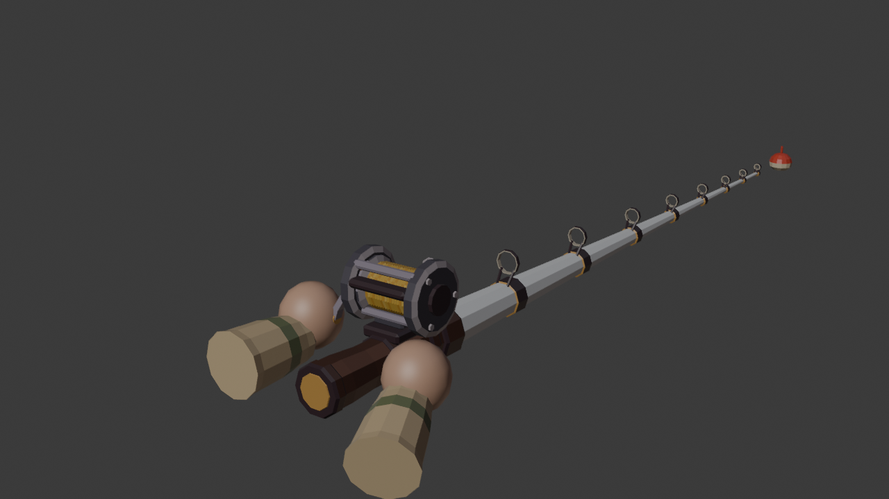
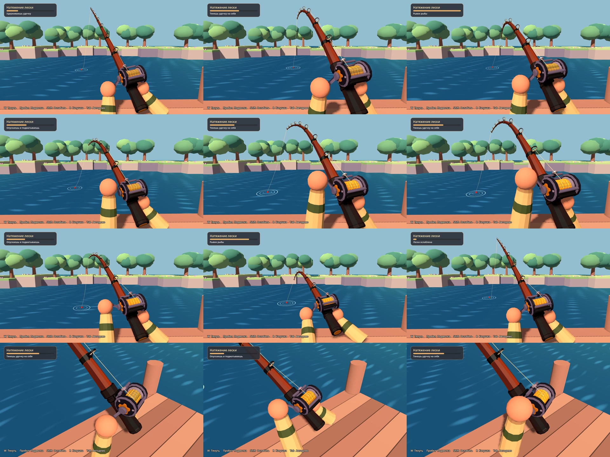

# Рыболовная удочка для Godot (Cedar Creek Fishing Rod)

Модель для вида от первого лица в стилистике cozy low-poly. Янтарный бланк, тёмная деревянная рукоять, круглая никелевая катушка с золотистой намоткой, две руки-кругляшки в рукавах и красно-белый поплавок.

| 3D Модель (Blender / GLB) | Раскадровка геймплея (Godot 4) |
| :---: | :---: |
|  |  |

---

## 🤖 Для ИИ-ассистентов (Qwen, Codex, Claude, ChatGPT)

Если вы работаете с этим репозиторием через нейросеть, используйте подготовленные текстовые спецификации и сводки:
- 📄 **[AI_CONTEXT.md](AI_CONTEXT.md)** — полное описание архитектуры, API функции `step()`, параметров и интеграции.
- 📐 **[BLENDER_SPEC.md](BLENDER_SPEC.md)** — разбор структуры 3D-модели (дерево нод, меши, полигоны, материалы).
- 🎬 **[VIDEO_SUMMARY.md](VIDEO_SUMMARY.md)** — покадровый разбор механики и визуальных состояний демо-видео.
- 📦 **[ALL_SCRIPTS_CONSOLIDATED.md](ALL_SCRIPTS_CONSOLIDATED.md)** — все GDScript и GLSL шейдеры в одном файле.
- 🖼️ **[previews/3d_renders/](previews/3d_renders/)** — рендеры катушки, рук и бланка с разных ракурсов.

---

## Запуск

1. Распакуй архив и открой `godot/project.godot` в Godot 4. Дождись импорта GLB и нажми F6 из `demo/demo.tscn` или F5 из редактора.
2. Автодемо покажет полный цикл вываживания: подъём удочки правой рукой, опускание с подмоткой и реакцию обеих рук на рывок. Нажми **Tab**, чтобы перейти на ручное управление.
3. Удерживай **W**, чтобы поднять удочку и потянуть на себя. Отпусти **W** и нажми **Пробел**, чтобы опустить удочку и выбрать леску. **Shift** ослабляет леску, **R** переключает на крупный план катушки. В демо при одновременном подъёме и подмотке левая рука крутит медленнее.

## Подключение к своей игре

Скопируй папку `godot/fishing_rod` целиком в корень проекта как `res://fishing_rod/`. Добавь `rod.tscn` дочерним узлом держателя удочки. Ось бланка в покое направлена по локальной −Z, +Y смотрит к катушке. Вызови `step()` один раз за кадр после обновления положения удочки и рыбы.

```gdscript
# line_socket — Marker3D на поплавке или у рта рыбы.
# tension и retrieve_strength имеют диапазон 0–1.
# drag_payout_mps — скорость выхода лески через фрикцион в м/с.
# lift_strength — усилие правой руки, от 0 (опустить) до 1 (тянуть).
# fish_jerk — сила текущего рывка рыбы от 0 до 1.
var collected_m: float = rod.step(
    delta,
    line_socket.global_position,
    tension,
    retrieve_strength,
    drag_payout_mps,
    lift_strength,
    fish_jerk
)
```

`collected_m` — сколько метров собрано за кадр. Отрицательное значение означает, что рыба стянула леску. Узел хранит количество выпущенной лески в `deployed_m`. При начале нового заброса выставь это значение по состоянию игры. Твоя система рыбалки рассчитывает натяжение, перемещение рыбы и момент срабатывания фрикциона. Последние два аргумента управляют позой. Их можно опустить при старом вызове step(). Чтобы передать короткий рывок, быстро подними fish_jerk и верни его к нулю. Для своего поплавка или вида от третьего лица можно выключить `show_float` и `show_hands`.

При подъёме правая рука тянет рукоять вверх и назад, а удочка поворачивается вокруг её ладони. При рывке катушка и обе руки подаются вперёд к рыбе. Движения рукавов привязаны к положению предплечий, а леска следует за удочкой. Под нагрузкой бланк плавно изгибается к цели. Вершинка гибче комля, а восемь колец двигаются по той же кривой, что и бланк. Леска идёт с касательной к шпуле через лесоукладыватель и кольца до заданной точки. При слабом натяжении отрезок после вершинки провисает. При подмотке шпуля крутится быстрее рукоятки с отношением 6,3:1, а лесоукладыватель ходит от края к краю. Когда леска выходит через фрикцион при остановленной ручке, шпуля крутится обратно, а рука остаётся на ручке. Скорость подмотки и амплитуда изгиба регулируются в инспекторе.

## Состав

- `godot/fishing_rod/` — сцена для встраивания, модель GLB, скрипт и шейдеры.
- `godot/demo/` — тестовая сцена с управлением, водой и двумя ракурсами.
- `blender/Cedar_Creek_Fishing_Rod.blend` — редактируемая модель в исходной позе с отдельными деталями и осями вращения. Изгиб и подмотка реализованы в сцене Godot.
- `Cedar_Creek_Fishing_Rod.mp4` — запись демо.

Удочка вместе с руками и поплавком — 7 736 треугольников в 20 поверхностях. Динамическая леска — ещё 270 треугольников в одной поверхности. Геометрия окружения демо считается отдельно. Проверено в Godot 4.6.3 с Compatibility на ПК.

## Механика реальной катушки

- [Abu Garcia Ambassadeur C4](https://www.abugarcia.com/collections/new-arrivals/products/ambassadeur-c4-round-reel-1656742) — круглая катушка, леворучная версия и отношение 6,3:1.
- [Bassmaster — намотка лески с Кристин Фишер](https://www.bassmaster.com/bassmasther/video/spooling-a-baitcast-reel-with-kristine-fischer/) — видеопример.
- [Abu Garcia — инструкция к Ambassadeur](https://s7d5.scene7.com/is/content/purefishing/Abu%20Garcia/Manuals/AMBASSADEUR%20ROUND%20REEL%20INSTRUCTION%20MANUAL.pdf) — схема заправки лески и фрикцион.
